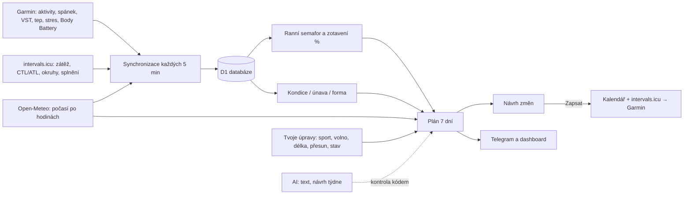

# Jak funguje Trenér (stav k 10. 11. 2026, večer)

Popis toho, co aplikace dělá, odkud bere data, jak plánuje týden a co na čem závisí. **Rozhoduje kód**
(`src/core/`), AI jen píše texty a návrhy, které kód zkontroluje.

## 1. Data

| Co | Odkud | Jak často |
|---|---|---|
| Aktivity, spánek, VST, klidový tep, stres, kroky, Body Battery, FIT soubory | Garmin Personal API | cron každých 5 min, ručně tlačítkem ⟳ |
| Zátěž (TSS / HRSS), kondice CTL, únava ATL, okruhy, splnění workoutu, decoupling | intervals.icu | po nové aktivitě a zpětně po dávkách |
| Počasí po hodinách (teplota, pocitová, srážky, vítr) | Open-Meteo (mix modelů / ALADIN) | po hodinách |

Kde intervals.icu data nemá (starší roky), aplikace zátěž a kondici dopočítá sama (`docs/data-zdroje.md`).

## 2. Ranní semafor a zotavení

Soubor `src/core/recovery.ts`, `src/core/readinessScore.ts`.

- **Normy** se počítají z tvých posledních 60 nocí (průměr a směrodatná odchylka).
- **VST (HRV):** pod normou → žlutý příznak, dva dny po sobě nebo hluboko pod → silnější.
- **Klidový tep:** žlutá nad `průměr + 2 SD` (aspoň +3 bpm), červená nad `průměr + 3 SD`.
- **Spánek:** proti potřebě spánku (cíl + vážený dluh), pod 5 h vždy červená.
- **Stav:** červený příznak nebo 3 žluté → 🔴 *Nezotavený*; 2 žluté → 🟡 *Částečně zotavený*; jinak 🟢 *Zotavený*.
- **Zotavení %** (kroužek): VST a tep ve spánku proti 60 nocím + délka spánku proti potřebě (jako Bevel).
  Pod 34 % je semafor aspoň žlutý, pod 15 % červený.
- **Spánková bilance:** `Σ 0,74^k × (spánek − cíl)` za 7 nocí – dnešní noc váha 1, včerejší 0,74 … nejstarší 0,16
  (stejně jako Sleep Bank v Bevelu, ověřeno na jejich grafu).

## 3. Kolik trénovat za týden (cíl zátěže)

Soubory `src/core/fitness.ts` (`weeklyLoadTarget`) a `src/core/plan.ts` (`weekTargetAdjusted`).

Zátěž týdne se odvozuje od tvé kondice (CTL = průměrná denní zátěž za posledních 6 týdnů):

| Cíl | Zátěž týdne | Co to dělá s kondicí |
|---|---|---|
| Zlepšit / Závod | 7 × CTL × 1,05–1,10 | roste, nejvýš o 3 body za týden |
| Udržet | 7 × CTL × 0,9–1,1 | drží se |
| Řízený pokles | 7 × CTL × 0,8–0,9 | pomalu klesá, forma roste |

Pojistky:
- týden nesmí být o víc než **30 %** těžší než tvůj běžný týden (týdny s nemocí nebo dovolenou se do „běžného“ nepočítají);
- po **3 týdnech růstu** přijde lehčí týden (−30 %), kromě Řízeného poklesu;
- když jsi hodně unavený (forma pod −20), týden je o 12 % lehčí, pod −30 o 25 %.

Na záložce Proč a Cíl je odhad, kam se kondice a forma posunou, když plán odjedeš (výpočet jako v intervals.icu:
kondice = klouzavý průměr zátěže za 42 dní, únava za 7 dní, forma = kondice − únava).

## 4. Jak se skládá týden

Soubor `src/core/plan.ts` (`generatePlan`).

1. **Počet tréninků plán volí sám.** Základ jsou 3 (u Řízeného poklesu 2). Když se cíl zátěže nevejde ani do
   nejdelších Z2, přidá další jízdu, raději o víkendu a v hezkém počasí. (Nastavení „tréninky týdně“ už není.)
2. **Nejvýš dní tréninku za sebou:** Zlepšit / Závod 3, jinak 2. Když vznikne delší řada (třeba po přesunu kvůli
   počasí nebo z AI návrhu), plán z nejkratší Z2 v řadě udělá volno. Tvoje volby a vlastní jízdy nechá být.
3. **Kvalita (intervaly):** březen–září až 2× týdně, jinak 1×. Nikdy dvě kvality po sobě.
   **Hokej se nepočítá jako tvrdý den** (hobby, hodina v klidu) – kvalita den po hokeji je v pořádku.
   Vynechaná kvalita se vymění za nejbližší vhodnou Z2.
4. **Délky:** Z2 se natáhnou tak, aby týden trefil cíl zátěže. Víkend delší, všední dny kratší.
   Nejdelší Z2 podle cíle, např. Řízený pokles v zimě: všední den 80 min, víkend 105 min.
5. **Jiný sport** (běh, běžky, chůze): jednotka podle tepu. Intervaly v běhu jen když běháš pravidelně
   (6+ běhů za 60 dní). Chůze je regenerace.
6. **Kalendář:** tréninky, které už jsou v intervals.icu, jsou základ; plán je jen upraví nebo přesune.

### Kvalitní jednotka
Soubor `src/core/qualityDesign.ts`. Žádná pevná knihovna:
- **zaměření** podle dat: mimo sezónu přednost VO2max a práh (klesají nejrychleji), ne stejné jako minule;
- **dávka** podle toho, jak jsi zvládl poslední stejnou jednotku;
- **watty** z tvé křivky výkonu, pásmo vždy ±10 W. U Řízeného poklesu je dávka o 30 % menší.

### Počasí
Soubory `src/core/weather.ts` a část „počasí“ v `plan.ts`. Plán se počítá znovu při každém otevření stránky
a ráno a večer v Telegramu, vždy s nejnovější předpovědí.
- Pro každý den se hledá nejlepší **3hodinové okno** na jízdu (tvoje teplotní hranice, déšť, vítr).
- **Kvalita** při špatném počasí, nebo v zimě bez dobrého okna → trenažér.
- **Z2** při špatném počasí → přesun na volný den téhož týdne s lepším počasím (jen když tím nevznikne moc dní
  za sebou), jinak trenažér na 2/3 délky zaokrouhlené na čtvrthodiny (1:30 venku → 1:00 na trenažéru).
- Den, který sis zvolil **sám**, se kvůli počasí nepřesouvá, jen dostane poznámku.
- Běh, běžky a chůze se podle počasí nemění.

### Dnešek podle ranního semaforu
- 🔴 → volno nebo Z1 do 45 min.
- 🟡 → kvalita se změní na Z2, Z2 se zkrátí o třetinu.
- 🟢 → beze změny.

## 5. Tvoje úpravy a AI návrh

- **Tvoje úpravy** (tlačítko Upravit, chat, Telegram): sport dne, volno, „místo toho Z2“ / „kvalita sem“, délka,
  vlastní jízda („v sobotu jedu 4 h s kamarádem“), přesun. Mají přednost před pravidly i počasím.
- **AI návrh týdne** (⋯ u plánu) se ukládá jako **doporučení** (v databázi s předponou `ai:`): plán ho použije,
  ale počasí, řada dní za sebou a limit kvality dál platí. Nejsou to „tvoje úpravy“.
- **Vrátit moje úpravy** smaže tvoje úpravy i AI doporučení a plán se spočítá znovu od nuly.
- **Stav** (nemoc, zranění, dovolená) plán zastaví; po nemoci 2 dny jen lehce, nic se nedohání.

## 6. Návrh změn a zápis do kalendáře

Soubor `src/plan/proposals.ts`.
- Každý přepočet porovná plán s kalendářem a vytvoří **návrh změn** (nová / upravit / přesunout / smazat).
- Nic se nezapíše samo: v Trenérovi **Zapsat do intervals.icu**, v Telegramu odpověď „ano“, „ano #1, #3“, „ne #2“.
- Po zápisu jde trénink do intervals.icu a odtud do Garminu (strukturovaný workout s watty / tepem).

## 7. AI

Soubor `src/llm/providers.ts`, `src/llm/llm.ts`.
- Pořadí modelů: Gemini 3.8 → 3.7 → 3.6 → 3.5 Flash → Nemotron Ultra (OpenRouter) → Gemma 31B → Mistral
  (Cloudflare). Přetížený model se 10 min přeskakuje.
- **AI návrh týdne** (`src/api/coach.ts`): AI dostane data a pravidla a navrhne dny → kód zkontroluje pravidla
  (`src/core/weekCheck.ts`) → při chybě druhý pokus s výčtem chyb → co AI netrefí, opraví kód. Výsledek je jen
  doporučení (viz kap. 5).
- **Chat, shrnutí na stránkách, zhodnocení aktivity:** AI vidí dnešek, plán, 30 dní zdraví, 45 dní aktivit,
  součty po měsících a letech. Odpověď s číslem, které v datech není, se zahodí nebo označí ⚠️.

## 8. Telegram (časy z Nastavení)

| Kdy | Co |
|---|---|
| ráno (5:30–11:00, jakmile je spánek a VST) | semafor, co dnes jet, co tělo potřebuje |
| do 30 min po aktivitě | rozbor aktivity (počká na okruhy z intervals.icu) |
| večer | zítřek + návrh změn |
| neděle večer | týdenní review a plán na další týden |
| 7–21 h | servis vybavení (řetěz, vosk…) |
