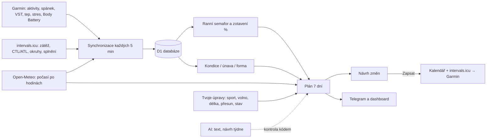

# Jak funguje Trenér (stav k 10. 11. 2026)

Popis toho, co aplikace dělá, odkud bere data, jak plánuje týden a co na čem závisí. **Rozhoduje kód**
(`src/core/`), AI jen píše texty a návrhy, které kód zkontroluje.

## 1. Data

| Co | Odkud | Jak často |
|---|---|---|
| Aktivity, spánek, VST, klidový tep, stres, kroky, Body Battery, FIT soubory | Garmin Personal API | cron každých 5 min, ručně tlačítkem ⟳ |
| Zátěž (TSS / HRSS), kondice CTL, únava ATL, okruhy, splnění workoutu, decoupling | intervals.icu | po nové aktivitě a zpětně po dávkách |
| Počasí po hodinách (teplota, pocitová, srážky, vítr) | Open-Meteo (mix modelů / ALADIN) | po hodinách |

Kde intervals.icu data nemá (starší roky), aplikace zátěž a kondici dopočítá sama (`docs/data-zdroje.md`).

## 2. Ranní semafor a zotavení

Soubor `src/core/recovery.ts`, `src/core/readinessScore.ts`.

- **Normy** se počítají z tvých posledních 60 nocí (průměr a směrodatná odchylka).
- **VST (HRV):** pod normou → žlutý příznak, dva dny po sobě nebo hluboko pod → silnější.
- **Klidový tep:** žlutá nad `průměr + 2 SD` (aspoň +3 bpm), červená nad `průměr + 3 SD`.
- **Spánek:** proti potřebě spánku (cíl + vážený dluh), pod 5 h vždy červená.
- **Stav:** červený příznak nebo 3 žluté → 🔴 *Nezotavený*; 2 žluté → 🟡 *Částečně zotavený*; jinak 🟢 *Zotavený*.
- **Zotavení %** (kroužek): VST a tep ve spánku proti 60 nocím + délka spánku proti potřebě (jako Bevel).
  Pod 34 % je semafor aspoň žlutý, pod 15 % červený.
- **Spánková bilance:** `Σ 0,74^k × (spánek − cíl)` za 7 nocí – dnešní noc váha 1, včerejší 0,74 … nejstarší 0,16
  (stejně jako Sleep Bank v Bevelu, ověřeno na jejich grafu).

## 3. Týdenní cíl zátěže

Soubor `src/core/fitness.ts` (`weeklyLoadTarget`) a `src/core/plan.ts` (`weekTargetAdjusted`).

| Cíl | Zátěž týdne |
|---|---|
| Zlepšit / Závod | 7 × CTL × 1,05–1,10 (nejvýš růst kondice +3 za týden) |
| Udržet | 7 × CTL × 0,9–1,1 |
| Řízený pokles | 7 × CTL × 0,8–0,9 |

Pojistky:
- nejvýš **+30 %** proti běžnému týdnu (slabé týdny – nemoc, dovolená – se do „běžného“ nepočítají);
- po **3 týdnech růstu** lehčí týden (−30 %), kromě Řízeného poklesu;
- **únava:** forma (CTL − ATL) pod −20 → týden o 12 % lehčí, pod −30 o 25 %.

## 4. Skladba týdne

Soubor `src/core/plan.ts` (`generatePlan`).

1. **Počet tréninků** z Nastavení (2–5). Řízený pokles: o jeden méně, kvalita zůstává.
2. **Nejvýš dní za sebou:** Zlepšit / Závod 3, jinak 2. Pak volno.
3. **Kvalita (intervaly):** březen–září až 2× týdně, jinak 1×. Nikdy dva dny po sobě ani den po hokeji.
   Vynechaná kvalita se vymění za nejbližší vhodnou Z2.
4. **Délky:** Z2 se natáhne tak, aby týden trefil cíl zátěže. Víkend delší (dlouhá jízda), všední dny kratší.
   Strop Z2 podle cíle: např. Pokles všední den 80 min, víkend 105 min (v zimě).
   Když se cíl nevejde ani do nejdelších Z2, přidá se jízda do volného dne (raději víkend a hezké počasí).
5. **Jiný sport** (běh, běžky, chůze): náhradní jednotka podle tepu. Běh s intervaly jen když běháš pravidelně
   (6+ běhů za 60 dní). Chůze je regenerace.
6. **Kalendář:** jednotky z intervals.icu, které už v kalendáři jsou, se berou jako základ; do blokovaných dnů
   se nepřesouvá.

### Kvalitní jednotka
Soubor `src/core/qualityDesign.ts`. Žádná pevná knihovna:
- **zaměření** z dat (mimo sezónu přednost VO2max a práh, ty klesají nejrychleji), bez opakování stejného zaměření
  jako minulý týden;
- **dávka** podle toho, jak jsi zvládl poslední jednotku stejného zaměření (žebříček času v zóně);
- **watty** z tvé křivky výkonu, pásmo vždy ±10 W.

### Počasí
Soubor `src/core/weather.ts`, část „počasí“ v `plan.ts`.
- Pro každý den nejlepší **3hodinové okno** na jízdu podle tvých teplotních hranic (Nastavení), deště a větru.
- **Kvalita** při špatném počasí (nebo v zimě bez dobrého okna) → trenažér.
- **Z2** při špatném počasí → přesun na volný den téhož týdne s lepším počasím, jinak trenažér na 2/3 délky.
- Den, který sis zvolil sám, se kvůli počasí nepřesouvá (jen poznámka).
- Běh, běžky a chůze plán podle počasí nemění.

### Dnešek podle semaforu
- 🔴 → volno nebo Z1 do 45 min.
- 🟡 → kvalita se změní na Z2, Z2 se zkrátí o třetinu.
- 🟢 → beze změny.

## 5. Tvoje úpravy

Úpravy se ukládají jako **omezení** (tabulka `constraints`) a plán se z nich vždy přepočítá:
sport dne, volno, „místo toho Z2“ / „kvalita sem“, délka, vlastní jízda („v sobotu jedu 4 h s kamarádem“),
přesun tréninku. **Stav** (nemoc, zranění, dovolená) plán zastaví; po nemoci 2 dny jen lehce, nic se nedohání.
„Vrátit moje úpravy“ smaže omezení a plán se spočítá znovu.

## 6. Návrh změn a zápis do kalendáře

Soubor `src/plan/proposals.ts`.
- Každý přepočet porovná plán s kalendářem a vytvoří **návrh změn** (nová / upravit / přesunout / smazat).
- Nic se nezapíše samo: v Trenérovi **Zapsat do intervals.icu**, v Telegramu odpověď „ano“, „ano #1, #3“, „ne #2“.
- Po zápisu jde trénink do intervals.icu a odtud do Garminu (strukturovaný workout s watty / tepem).

## 7. AI

Soubor `src/llm/providers.ts`, `src/llm/llm.ts`.
- Pořadí modelů: Gemini 3.8 → 3.7 → 3.6 → 3.5 Flash → Nemotron Ultra (OpenRouter) → Gemma 31B → Mistral
  (Cloudflare). Přetížený model se 10 min přeskakuje.
- **AI návrh týdne** (`src/api/coach.ts`): AI dostane data a pravidla a navrhne dny → kód zkontroluje pravidla
  (`src/core/weekCheck.ts`) → při chybě druhý pokus s výčtem chyb → co AI netrefí, opraví kód.
- **Chat, shrnutí na stránkách, zhodnocení aktivity:** AI vidí dnešek, plán, 30 dní zdraví, 45 dní aktivit,
  součty po měsících a letech. Odpověď s číslem, které v datech není, se zahodí nebo označí ⚠️.

## 8. Telegram (časy z Nastavení)

| Kdy | Co |
|---|---|
| ráno (5:30–11:00, jakmile je spánek a VST) | semafor, co dnes jet, co tělo potřebuje |
| do 30 min po aktivitě | rozbor aktivity (počká na okruhy z intervals.icu) |
| večer | zítřek + návrh změn |
| neděle večer | týdenní review a plán na další týden |
| 7–21 h | servis vybavení (řetěz, vosk…) |
