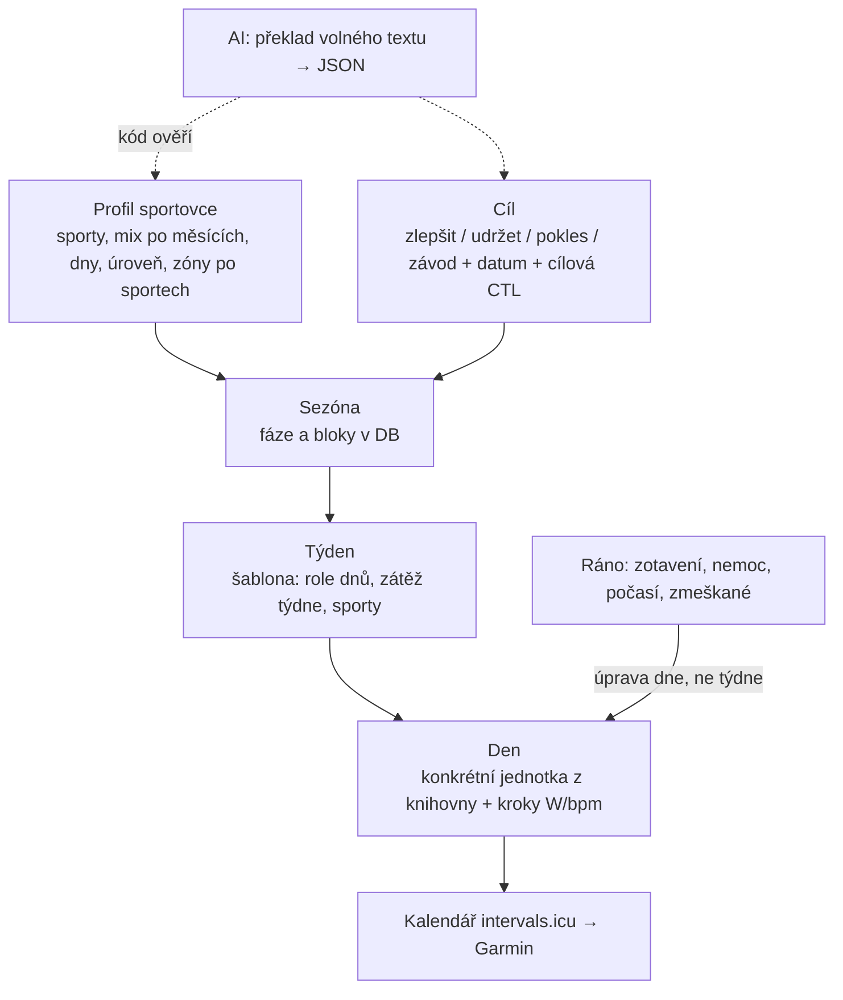

# Trenér v2 – návrh přestavby (zadání pro implementaci)

Stav k 11. 11. 2026. Tento dokument je **zadání** pro přestavbu funkčnosti Trenéra (ne vzhledu – UI na mobilu
zůstává). Přílohy:

- [`8020-knihovna.md`](8020-knihovna.md) – 80/20 zóny, knihovna tréninků (kolo, běh) a pravidla plánů jako data.
- [`../jak-funguje-trener.md`](../jak-funguje-trener.md) – jak trenér funguje dnes (v1).
- [`../knihovna-treninku.md`](../knihovna-treninku.md) – dnešní kvalitní jednotky (VO2, práh, sweet spot, 30/15).

Na konci je hotový **prompt** pro silnější model (kap. 12).

---

## 1. Proč přestavba

Trenér je hlavní funkce stránky, ale pořád dělá chyby, které se opravují záplatami:

| Co uživatel vidí | Proč to dnes vzniká (v1) |
|---|---|
| Cíl „Řízený pokles“, kondice mírně klesá – a plán stejně pokles nepřinese | Cíl zátěže se každý týden počítá znovu jako `7 × CTL × 0,8–0,9` z **aktuální** kondice (`fitness.ts → weeklyLoadTarget`). Nemá žádný cílový bod (kam a do kdy), nehlídá, jestli se kondice opravdu hýbe, a „dorovnání zátěže“ v `plan.ts` (přidá jízdu, když týden nedosáhne cíle) jde proti poklesu. |
| Tréninky čt, pá, so, v neděli volno, pak zase 3 dny po sobě | Plán je **klouzavé okno 7 dní od dneška**, ne kalendářní týden se šablonou. Každý přepočet poskládá dny znovu; pravidlo „max. 3 dny za sebou“ se kontroluje až dodatečně a jen uvnitř okna, takže na hraně dvou oken vznikají řady. Dny nemají pevné role (klíčový den, dlouhý den, volno). |
| Kvalita / délky se mění při každém otevření stránky | Žádná paměť: plán nemá fázi, blok ani týden v cyklu. Vše se odvozuje z dnešních čísel. |
| Sport (kolo × běh × běžky) se řeší jen ručně po dnech | Neexistuje profil sportů a sezónní mix. Běh je „náhrada za kolo“ (`workout.ts → otherWorkout`), ne plnohodnotná součást plánu. |
| Popisky aktivit neseděly se zónami v grafu | Opraveno 11. 11. (čas v zónách z intervals.icu po přepočtu zón). V2 musí mít **zóny po sportech** (kolo a běh mají v intervals.icu jiné zóny tepu). |

`src/core/plan.ts` má 1136 řádků pravidel a výjimek. Přestavba = **nová vrstva plánování**, ne další pravidla do v1.

## 2. Principy (z 80/20 Endurance, Seiler, Friel)

Zdroj: 22 stránek 8020endurance.com (seznam v příloze) + knihovna tréninků. Pravidla, která v2 musí dodržet:

1. **80/20 podle času, za týden**: ~80 % času v zónách 1–2, ~20 % v zóně 3 a výš. Zóny X a Y (mezi pásmy) nejsou
   cíl – je to „šedá zóna“. Měří se čas v zónách, ne počet jednotek.
2. **Každý den má účel**: zátěžový (klíčový), regenerační, nebo přípravný. Žádný „trochu rychlejší“ den bez účelu.
3. **Nikdy 3 těžké dny za sebou** (těžký = intervaly nebo dlouhý trénink). Klíčové dny odděluje aspoň 1 lehký den.
4. **Týdenní šablona má kotvy**: volno (výchozí pondělí), nejdelší trénink na konci týdne (sobota/neděle).
   Šablonu jde posunout podle uživatele, ale role dnů se nepřeskupují náhodně.
5. **Stupňovité cykly**: zátěž roste 2–3 týdny, pak odpočinkový týden −30 až −40 % objemu. Kolo a běh: každý
   3. týden. V odpočinkovém týdnu je test (nahradí nejtěžší jednotku).
6. **Zmeškaný trénink se nedohání**. 1–2 zmeškané → pokračuj podle plánu. Delší pauza / nemoc → pár dní lehce,
   pak navázat. Hodně dlouhá pauza → začít blok znovu.
7. **Ladění před závodem 10–14 dní**: objem dolů, intenzita zůstává v krátkých dávkách, žádný dlouhý ani těžký
   trénink na poslední chvíli. Cíl: CTL −5–10 %, forma (TSB) v den závodu +10 až +20.
8. **Úroveň (Level 0–3) = hodiny, které zvládneš udržet většinu týdnů**, ne ty, které bys chtěl. Při váhání nižší.
9. **Zóny z vlastního prahu** (FTP, LTHR, prahové tempo), **zvlášť pro každý sport**. Kolo: výkon hlavní, tep
   kontrolní. Běh: tep nebo tempo. Na trenažéru je práh o 5–10 bpm a 10–15 W nižší.
10. **Intervaly rovnoměrně, ne naplno**: střed zóny. Když je úsek o >3 % pomalejší / slabší než předchozí, sérii
    ukonči a dojeď v Z1–2.
11. **Náhrada sportu**: lehkou (Z1–2) jednotku jde nahradit jiným sportem stejné délky a intenzity. Zátěž se
    počítá v každém sportu proti jeho prahu (TSS kola ≠ TSS běhu, převod 80/20 nedává – viz kap. 6.4).
12. **Hierarchie (Seiler)**: 1) celkový objem v nízké intenzitě, 2) dávka vysoké intenzity, 3) rozložení,
    4) periodizace. Detaily periodizace mají malý vliv – hlavně ať zátěž dlouhodobě roste a nejspecifičtější
    jednotky jsou blízko cíle.

Co 80/20 web **neříká** (doplnit z jiných zdrojů – Friel *Training Bible*, Seiler): pevné fáze base/build/peak
s délkami, procento růstu týden po týdnu, zimní přechodné období. Návrh níže to doplňuje (kap. 4) – označeno ⚑.

## 3. Architektura v2



Čtyři vrstvy, každá **uložená v DB** (paměť), každá se přepočítává jen když se změní její vstup:

| Vrstva | Kdy se přepočítá | Výstup |
|---|---|---|
| **Sezóna** | změna cíle, nový závod, konec bloku, dlouhá pauza | seznam bloků (fáze, týdny, cílová CTL na konci bloku) |
| **Týden** | neděle večer (nový týden), změna dostupnosti, nemoc | role 7 dní (po–ne), sport každého dne, zátěž týdne |
| **Den** | ráno (zotavení), počasí, ruční úprava | jednotka z knihovny, délka, kroky s cílem W / bpm |
| **Kontrola** | po každé aktivitě | splnění, 80/20 za týden, odchylka CTL od trajektorie → zpětná vazba do Týdne |

Klíčová změna proti v1: **týden je kalendářní (po–ne) a jeho kostra se během týdne nemění.** Mění se jen obsah
dnů (zkrácení, Z2 místo kvality, přesun v rámci týdne). Tím zmizí „čt-pá-so, volno, pak 3 dny“.

## 4. Sezóna a cíle (⚑ doplněno z Friela)

### 4.1 Cíle (řeší i „pokles“)

Každý cíl = **trajektorie CTL** (kondice) s datem, ne násobek dnešní CTL:

| Cíl | Trajektorie | Pozn. |
|---|---|---|
| Zlepšit | +2 až +5 CTL / týden (podle úrovně), stupňovitě 3:1 | strop: akutní/chronická ≤ 1,3 |
| Udržet | CTL ± 2 | 1 klíčový den / týden stačí |
| Řízený pokles (zima) | zadaný pokles, např. −15 % CTL za 8 týdnů → pak Udržet | **kód hlídá skutečný průběh**; když CTL neklesá, další týden ubere |
| Závod | z dnešní CTL na cílovou CTL v den D−14, pak ladění | počet týdnů → fáze base/build/peak/taper |

**Výpočet zátěže týdne z trajektorie** (uzavřený vzorec, žádné hádání):

```
k = 1 − 1/42 (CTL), k7 = k^7 ≈ 0,8448
denní zátěž d potřebná, aby CTL za 7 dní byla C_cíl:
  d = (C_cíl − C_teď · k7) / (1 − k7)
zátěž týdne = 7 · d   (rozdělená podle šablony dnů)
```

Příklad: CTL 45, cíl pokles na 43 za týden → d = (43 − 45·0,8448)/0,1552 ≈ 32 → týden ≈ 225.
v1 by dal 0,85 · 7 · 45 ≈ 268 → CTL by klesla jen na ≈ 44,0 (a dorovnání zátěže v plánu to ještě zmírní).

**Zpětná vazba**: každou neděli porovnej skutečnou CTL s trajektorií. Rozdíl se nepřenáší naráz – další týden
opraví nejvýš polovinu odchylky (aby jeden vynechaný týden nezpůsobil skok).

### 4.2 Fáze (bloky)

| Fáze | Délka | Obsah | Klíčové dny / týden |
|---|---|---|---|
| Přechod (po sezóně) | 2–4 týdny | volně, jiné sporty, bez struktury | 0 |
| Base 1–3 | 3–4 týdny každá | Foundation + dlouhý den; od Base 2 Fast Finish / Speed Play | 1 |
| Build 1–2 | 3–4 týdny | Cruise intervaly, Tempo, Anaerobic (podle cíle) | 2 |
| Peak | 1–2 týdny | závodně specifické | 2 |
| Taper | 10–14 dní | objem −40 až −60 %, krátké ostré úseky | 1 (krátký) |
| Udržování (zima / bez cíle) | neomezeně, cykly 3+1 | Foundation + 1 kvalita, víc běhu / běžek podle mixu | 1 |

Bez závodu se jede **Udržování** nebo **Base** podle cíle. Blok = 2 nebo 3 týdny růstu + 1 odpočinkový (3:1 pro
mladší / zkušené, 2:1 pro Level 0 nebo po nemoci).

## 5. Týden: šablona rolí

Role dne: `rest`, `easy` (Z1–2 krátké), `foundation` (Z2), `key` (kvalita), `long` (dlouhý Z2, může mít Fast
Finish), `test`. Šablona podle počtu tréninků (z úrovně a dostupnosti):

| Tréninků | Po | Út | St | Čt | Pá | So | Ne |
|---|---|---|---|---|---|---|---|
| 3 | rest | key | rest | foundation | rest | long | rest |
| 4 | rest | key | foundation | rest | foundation | long | rest |
| 5 | rest | key | foundation | key* | rest | long | easy |
| 6 | rest | key | foundation | key* | easy | long | foundation |

`key*` jen ve fázi s 2 klíčovými dny, jinak `foundation`. Pravidla:

- Volno a dlouhý den jsou kotvy, jejich dny si uživatel nastaví v profilu (např. dlouhý v neděli).
- Klíčové dny nikdy vedle sebe ani vedle dlouhého dne, kromě volby uživatele.
- **Nejvýš 3 tréninky za sebou, a pravidlo platí přes hranu týdne** (kontroluje se i ne → po).
- Přesun kvůli počasí / času jen **v rámci týdne** a jen tak, aby platila pravidla výš. Když to nejde, jednotka se
  zkrátí nebo přesune na trenažér, ne do dalšího týdne.
- Odpočinkový týden: stejná šablona, objem −35 %, klíčový den nahradí test nebo krátké Speed Play.
- Hokej a jiné pevné aktivity uživatele jsou v šabloně jako `fixed` (počítá se jejich zátěž, nejsou to klíčové dny).

Rozdělení zátěže týdne: dlouhý den 25–35 %, klíčové dny dohromady 30–40 %, zbytek rovnoměrně do foundation /
easy. Kontrola 80/20 na odhad časů v zónách (kroky jednotek mají zóny, takže jde spočítat předem).

## 6. Sporty a mix

### 6.1 Profil sportů (nové nastavení – bod „výběr sportu“)

Strukturovaný profil v DB (tabulka `athlete_profile` nebo klíč v `settings`):

```jsonc
{
  "primary": "ride",
  "sports": {
    "ride":   { "enabled": true,  "indoor": true },
    "run":    { "enabled": true,  "maxPerWeek": 2, "maxMin": 75, "quality": false },
    "xc_ski": { "enabled": true,  "onlyWhenSnow": true },
    "walk":   { "enabled": false }
  },
  // podíl času po měsících (0–1); co chybí do 1 = primární sport
  "seasonMix": [
    { "months": [11, 12, 1, 2], "run": 0.35, "xc_ski": 0.15 },
    { "months": [3, 4, 5, 6, 7, 8, 9, 10], "run": 0.1 }
  ],
  "days": { "rest": ["mon"], "long": "sun", "unavailable": [], "fixed": [{ "dow": "thu", "sport": "hockey", "min": 60 }] },
  "level": 1,              // 0–3, hodiny týdně viz 8020-knihovna.md
  "weeklyHours": { "min": 5, "max": 9 }
}
```

### 6.2 Zadání přes AI (návrh uživatele)

V Nastavení / Trenér → Cíl pole „Řekni trenérovi, jak chceš trénovat“:

> „Chci se primárně zaměřit na kolo, ale můžeme to prokládat i během, přes zimu víc běhu, v neděli dlouhá jízda,
> ve čtvrtek hokej.“

1. AI dostane **JSON schéma profilu** a dnešní profil, vrátí jen JSON (žádný text).
2. Kód JSON **validuje** (schéma, rozsahy, součet mixu ≤ 1, známé sporty). Neplatné → druhý pokus s chybami,
   pak chyba uživateli.
3. Uživatel vidí **shrnutí změn lidsky** („Běh: až 2× týdně, v listopadu–únoru 35 % času. Dlouhý den: neděle.“) a
   potvrdí. Teprve pak se uloží a přepočítá sezóna / týden.
4. Vedle toho stejné nastavení **ručně** (přepínače sportů, posuvník mixu po měsících, dny). AI je jen zkratka.

Stejný mechanismus pro cíl: „chci v zimě mírně shodit kondici a od března stavět na Gran Fondo 15. 6.“ → cíl
Pokles do 28. 2. + Závod 15. 6. (typ Gran Fondo 120–160 km).

### 6.3 Výběr sportu dne

Týden má role; sport se přiřadí až potom:
- `key` a `long` = primární sport (kolo), pokud profil neříká jinak (běh `quality: true`).
- Mix se plní přes `foundation` / `easy` dny: vyber dny, aby čas běhu ≈ podíl z `seasonMix`, max. `maxPerWeek`.
- Běh nikdy 2 dny po sobě, pokud uživatel neběhá pravidelně (dnes: 6+ běhů za 60 dní).
- Běžky jen když `onlyWhenSnow` a je sníh (počasí / ruční přepínač „je sníh“).

### 6.4 Zátěž napříč sporty

80/20 převod nedává. Použij:
- **Zátěž (TSS/HRSS) z intervals.icu** pro každou aktivitu – CTL v intervals.icu je společná přes sporty, a na
  tu se plánuje.
- Náhrada běhu za kolo: **stejná doba a stejná zóna** (80/20), ne stejný TSS. Odhad zátěže běžecké jednotky
  ber z historie uživatele (medián HRSS/h běhu v Z2), ne z kola.
- Běh je pro pohybový aparát náročnější: v prvních 4 týdnech zvyšování běhu max. +10 % času běhu týdně.

## 7. Knihovna jednotek

Místo dnešních generátorů (`z2Workout`, `intervalWorkout`, `qualityDesign.ts`) **datová knihovna** podle 80/20
(plný výpis v příloze):

| Rodina | Kód 80/20 | Fáze | Role |
|---|---|---|---|
| Regenerace | CRe / RRe | vše | easy |
| Foundation | CF / RF | vše | foundation |
| Dlouhá | CF dlouhé / RL | vše | long |
| Fast Finish | CFF / RFF | Base 2+ | long / foundation |
| Speed Play | CSP / RSP | Base 2+, udržování | key (lehčí) |
| Force (kopce, 30 s – 1,5 min Z5) | CFo / RHR | Base 3, Build | key |
| Cruise intervaly (Z3) | CCI / RCI | Build, udržování | key |
| Tempo (Z3 souvisle) | CT / RT | Build, test | key / test |
| Anaerobic (2,5 min Z4) | CAn / RAn | Build 2, Peak | key |
| Mixed | CMI / RMI | Peak | key |
| Taper | – / RTa | Taper | key |

Pravidla:
- **Postup v rodině podle délky v cílové zóně** (čísla 80/20 jsou pořadí vzniku, ne obtížnost – seřadit podle
  minut v zóně). Další jednotka stejné rodiny = o 1 krok výš, jen když minulá byla splněná (≥ 90 % a RPE / tep
  v pořádku); po nesplnění zůstává; po nemoci / odpočinkovém týdnu o 1–2 kroky níž.
- **Zóny → čísla až při vytvoření kroků**, podle sportu: kolo W z FTP (a tep jako druhý cíl), běh / běžky tep
  z LTHR běhu (nebo tempo). Tabulky % v příloze.
- Dnešní žebříčky VO2 / práh / sweet spot z `knihovna-treninku.md` zůstávají jako **doplňková rodina**
  „Sweet spot“ (80/20 ji nemá, ale je to zóna X → používat střídmě, v udržování v zimě ano, v Build ne).
- Výběr zaměření podle slabin (pokles křivky výkonu) z v1 lze zachovat – rozhoduje jen mezi rodinami povolenými
  ve fázi.

### 7.1 Cíl tepu v krocích (požadavek 11. 11.)

intervals.icu od 11. 11. 2026 posílá do Garminu workout i s cílem tepu místo wattů. V2:
- Každý krok má `target: { power?: [lo, hi] W, hr?: [lo, hi] bpm, hrZone?: "Z2", pace?: … }`.
- **Kolo**: primárně W, tep jako doplněk v popisu kroku (do Garminu jde jeden cíl – W).
- **Běh, běžky, chůze, MTB bez wattmetru**: cíl tep. Do intervals.icu jako `- 40m 81-90% LTHR` (80/20 pásma
  přímo v % LTHR) nebo `Z2 HR`. V aplikaci zobrazit **bpm** spočítané ze **zón daného sportu** (intervals.icu má
  pro běh jiné zóny tepu než pro kolo – načíst `sport-settings` pro Ride, Run, NordicSki zvlášť a uložit).
- Dnes (v1) už běh a běžky jdou jako `Z2 HR` – intervals.icu si to přeloží podle zón běhu. Chybí jen zobrazení bpm
  v aplikaci a % LTHR místo zón.

## 8. Denní úpravy (ráno a během týdne)

| Situace | Co se stane |
|---|---|
| 🟢 zotavený | beze změny |
| 🟡 částečně | `key` → `foundation` stejné délky (nebo Speed Play nejnižší úroveň); `long` −25 % |
| 🔴 nezotavený | `easy` do 45 min nebo volno |
| Zmeškaný klíčový den | nedohání se; pokud zbývají v týdnu ≥ 2 dny a pravidla to dovolí, klíčový přesuň, jinak propadá |
| Nemoc / zranění (stav) | plán stojí; po návratu 2–3 dny easy, pak týden −30 % a o 1–2 kroky níž v rodinách |
| Pauza > 14 dní | nový blok od Base (nebo od začátku aktuální fáze) |
| Špatné počasí | kvalita na trenažér; Z2 přesun v týdnu nebo trenažér 2/3 délky (pravidla z v1) |
| Uživatel jede víc (skupina) | zátěž se započte, další dny týdne se zkrátí, aby týden seděl na trajektorii |

## 9. Datový model (nové tabulky – migrace + `TENANT_TABLES`)

```sql
-- sezóna: bloky
CREATE TABLE plan_blocks (id INTEGER PRIMARY KEY, start TEXT, end TEXT, phase TEXT, week_pattern TEXT, -- "3:1"
  ctl_start REAL, ctl_target REAL, goal TEXT, created_at TEXT);
-- týden: kostra (role dnů), zátěž, stav
CREATE TABLE plan_weeks (week_start TEXT PRIMARY KEY, block_id INTEGER, idx_in_block INTEGER, is_recovery INTEGER,
  load_target REAL, roles_json TEXT, sports_json TEXT, ctl_expected REAL, ctl_actual REAL, frozen INTEGER);
-- postup v rodinách knihovny
CREATE TABLE workout_progress (family TEXT PRIMARY KEY, sport TEXT, level INTEGER, last_date TEXT, last_ok INTEGER);
-- profil (nebo settings.athlete_profile JSON)
```

Dnešní `plan_overrides`, `proposals`, kalendář a zápis do intervals.icu (`src/plan/proposals.ts`) zůstávají –
v2 jen mění, **co** se navrhuje.

## 10. Postup implementace (po krocích, každý s testy)

1. **Čisté funkce v `src/core/v2/`**: `trajectory.ts` (zátěž z cílové CTL), `season.ts` (bloky z cíle a data),
   `weekTemplate.ts` (role dnů + pravidla), `library.ts` (data z přílohy + postup), `assign.ts` (sport dne podle
   mixu), `adapt.ts` (ranní úpravy). Testy ve `test/v2/`.
2. **Akceptační testy ze skutečných situací** (musí projít, než se v2 zapne):
   - Pokles: CTL 45, cíl −15 % za 8 týdnů → po simulaci 8 týdnů splněného plánu CTL 37–39.
   - Pokles + uživatel jede navíc 150 km → další týden se ubere, trajektorie se vrátí do ±2 za 2 týdny.
   - Nikdy 4 tréninky za sebou přes hranu týdne (simulace 12 týdnů, náhodné posuny počasím).
   - Středa 11. 11.: týden po–ne má pevné role; přepočet ve čt / pá nemění role dnů.
   - Zima, mix běh 35 %: běh 1–2× týdně, nikdy 2 dny po sobě, kvalita na kole.
   - 80/20: plánovaný týden má ≥ 75 % času v Z1–2.
   - Odpočinkový týden každý 3. (nebo 4.) týden, objem −30 až −40 %.
3. **Profil sportů + AI zadání** (kap. 6.2) – Nastavení a karta Cíl.
4. **Napojení**: `src/api/routes.ts` (`/coach`) a Telegram berou plán z v2 za přepínačem `settings.coach_v2`.
   v1 zůstane, dokud v2 neběží 2 týdny bez ručních oprav.
5. **UI** (bez nového designu): v kartě Plán přidat řádek „Blok Base 2 · týden 2 ze 3 · odpočinkový za 1 týden“,
   v kartě Cíl trajektorii CTL (graf: skutečnost + plán do konce bloku). Kroky s bpm.
6. **Dokumentace**: přepsat `docs/jak-funguje-trener.md`.

Limity free plánu platí (10 ms CPU v cronu): sezóna a týden se počítají jen při změně a ukládají; denní přepočet je
levný (jen den).

## 11. Další body z kola 11. 11. (mimo přestavbu)

- **Barva zvýraznění (oranžová) v Nastavení** – zjištěno: oranžová je v CSS jako proměnné `--acc`, `--acc2`,
  `--accbg` (6 míst: světlý / tmavý režim × 2 motivy) a používá se přes ně ve ~110 místech. Natvrdo je jen
  barva trasy na mapě (3× v `app.js`) a `--z5` (zóna 5 = oranžová, to je barva zóny, ne zvýraznění). Náročnost:
  **malá** (~1–2 h): výběr barvy v Nastavení → `data-accent="blue|red|green|gray"` na `<html>` → v CSS pro každou
  barvu 3 proměnné × světlý / tmavý. Úskalí: **zelená** koliduje s `--ok` (splněno / hotovo – pruh zátěže, proužek
  dnů), **červená** s `--bad`. Řešení: u zelené a červené přepnout proužek a pruh zátěže na neutrální „plán“
  barvu (šedá / modrá), nebo zelenou a červenou nenabízet.
- Hotovo 11. 11.: kvalita pod datem, ikona sportu místo ⚡, odtrénovaná kvalita tmavší zelenou, prázdné dny
  tečkou, „Odtrénováno“ tučně, 30denní graf kondice v kartě Stav, AI štítek zúžený na 🤖, zóny tepu z intervals.icu.

## 12. Prompt pro implementaci (Fable 5.2)

```text
Pracuješ v repozitáři trener-app (Cloudflare Workers, TypeScript, Hono, D1). Přečti AGENTS.md,
docs/trener-v2/README.md (zadání) a docs/trener-v2/8020-knihovna.md (data), pak docs/jak-funguje-trener.md
a src/core/plan.ts (dnešní trenér v1).

Úkol: postav Trenéra v2 podle zadání – nová plánovací vrstva v src/core/v2/ (čisté funkce bez I/O),
uložená sezóna a týdny v D1 (nové migrace + TENANT_TABLES), profil sportů s nastavením přes AI (AI vrací jen
JSON, kód validuje, uživatel potvrdí), knihovna jednotek podle 80/20 jako data, kroky s cílem W i bpm podle
zón daného sportu. Postupuj podle kap. 10: nejdřív čisté funkce a akceptační testy z kap. 10 bod 2, teprve
pak napojení za přepínačem settings.coach_v2. UI nepřestavuj, jen doplň řádky z kap. 10 bod 5.

Pravidla: texty česky, tykání; rozhoduje kód, AI jen překládá text na JSON a píše texty; limity free plánu
(10 ms CPU v cronu, 50 D1 dotazů); npm run typecheck && npm test před každým commitem; malé commity.
Když narazíš na rozpor v zadání nebo chybějící číslo, zapiš ho do docs/trener-v2/otazky.md a pokračuj
rozumnou volbou, kterou tam zdůvodníš.
```

## 13. Otevřené otázky pro uživatele

1. Dny: který den chceš mít pevné volno a který dlouhý trénink (dnes plán dává víkend)? Hokej každý čtvrtek?
2. Úroveň: kolik hodin týdně zvládneš udržet většinu týdnů v zimě a v sezóně?
3. Máš na příští rok závod / cíl s datem? (Bez něj: zima Pokles / Udržování, od jara Base → Build.)
4. Běh: jak často chceš v zimě běhat a smí mít běh intervaly?
5. Knihy Joe Friela (*Training Bible*, *Fast After 50*): pokud je dodáš (PDF), doplním fáze a postup zátěže
   (kap. 4.2 je zatím odvozená z obecně známého Frielova modelu, ne z textu knihy).
