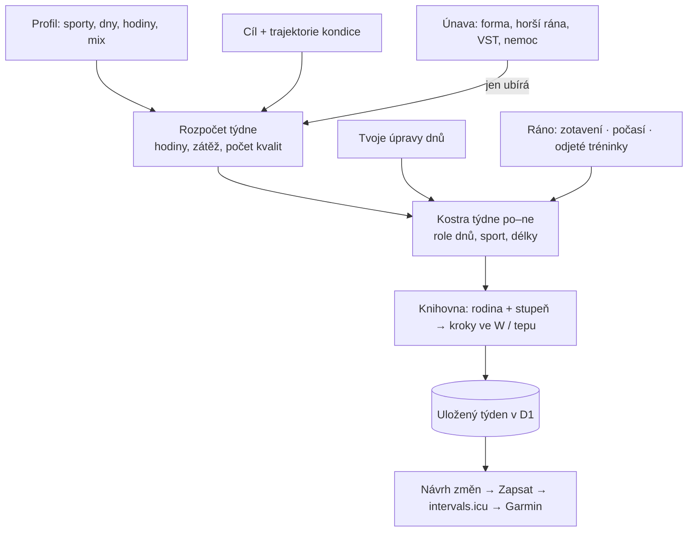

# Jak funguje Trenér v2 (stav k 11. 11. 2026)

Nový plánovač za přepínačem **Nastavení → Trenér – profil → Nový trenér** (`settings.coach_v2`). Když je vypnutý,
běží původní trenér (`docs/jak-funguje-trener.md`). Vzhled stránky je stejný, mění se, **co** se plánuje.
Proč a jak se návrh liší od zadání, je v [`review.md`](review.md).

## 1. Zóny

Trenér používá **zóny uživatele z Garminu** (kolo 55–75–90–105–120–150 % FTP, tep podle Garminu). Stupnici
80/20 Endurance nepřebírá – jejich „Z2“ (70–83 % FTP, 81–90 % LTHR) je v běžném dělení z velké části tempo.
Z 80/20 je princip (většina času lehce, málo intenzivně, každý den má účel) a stavba tréninků, přeložená
podle prahu: jejich Z1 → Z1, Z2 → Z2, X → Z3, Z3 → Z4, Z4 → Z5.

## 2. Profil (`src/core/coach/profile.ts`)

Každý uživatel má svůj (`settings.coach_profile`). Nastaví se ručně v Nastavení nebo větou přes AI
(AI vrátí jen JSON, kód ho zkontroluje, uživatel potvrdí). Nový uživatel dostane odhad z historie.

- hlavní sport (kolo / běh), další sporty se stropy (kolikrát týdně, nejdéle, intervaly ano / ne);
- podíl času dalších sportů v zimě a v sezóně; běžky jen se zapnutým „Je sníh“;
- oblíbené dny, dny, kdy nemůžeš, den dlouhého tréninku;
- hodiny týdně od–do pro sezónu, zimu a zimu se sněhem.

## 3. Rozpočet týdne (`budget.ts`)

1. **Trajektorie kondice (CTL)** od dne, kdy byl cíl nastaven: Zlepšit + `ramp` bodů týdně v zátěžových týdnech,
   Udržet 0, Pokles −1, Závod růst a 10–14 dní ladění. Každý týden se opraví nejvýš polovina odchylky.
2. Zátěž týdne vzorcem `7 × (C_cíl − C_teď × 0,847) / 0,153`.
3. **Hodiny z profilu jsou pásmo**: strop vždy, spodní hranice mimo lehčí týden. Když se cíl do hodin nevejde,
   trenér napíše, kde se kondice ustálí a kolik hodin by bylo potřeba.
4. Zlepšit a Závod jedou v blocích **3 týdny + 1 lehčí** (65 % zátěže předchozího týdne).
5. Pojistky: nejvýš +15 % proti běžnému týdnu nebo +10 % proti poslednímu plnému, poměr 7/28 dní do 1,3.
6. **Únava jen ubírá**: forma pod −20 / −30, 2–3 horší rána za 5 dní, týdenní VST pod normou, dny po nemoci →
   rozpočet × 0,9 až 0,7 a méně kvalit.
7. Kvalit týdně: do 4 h 1; do 7 h 1 (Základ) nebo 2 (Rozvoj); nad 7 h 2; lehčí týden, ladění a Pokles 1.

Režimy: **Základ** (zima při Zlepšit), **Rozvoj** (sezóna), **Udržování** (Udržet, Pokles), **Ladění** (před závodem).

## 4. Kostra týdne (`week.ts`)

Role dne: volno, lehký (Z1), vytrvalost (Z2), klíčový (kvalita), dlouhý. Řešič projde kombinace dnů a rolí.

Tvrdá pravidla: dny, kdy nemůžeš; nejvýš 3 tréninky za sebou i přes hranu týdne; klíčový den ne den po klíčovém
ani po dlouhém; tvoje úpravy dnů platí. Bodují se oblíbené dny, dlouhý o víkendu / ve zvoleném dni, klíčový po
volnu, rozestup kvalit, počasí a **shoda s dřívější kostrou** (proto se týden nepřeskupuje).

Sport: klíčový a dlouhý v hlavním sportu, další sporty do vytrvalostních dnů podle podílu a stropu. Běh ne dva
dny po sobě, dokud neběháš pravidelně; nejdelší běh nejvýš 1,1× nejdelšího za 4 týdny.

## 5. Tréninky (`library.ts`)

Rodiny se žebříčkem (stupeň = minuty v cílové zóně): tempo, sweet spot, práh, VO2, VO2 30/15, krátké ostré;
k tomu regenerace, vytrvalost, dlouhá a dlouhá s rychlým závěrem. Rodiny klíčových dnů se střídají podle režimu
a podle toho, co se nejelo nejdéle. Kolo má kroky ve wattech, běh / běžky / kolo bez wattmetru v tepu
(bpm ze zón Garminu; do intervals.icu jde stejný cíl jako % LTHR, protože bpm jejich zápis neumí).

Postup (`progress.ts`): po čistě zvládnuté jednotce o stupeň výš (jen Zlepšit a Závod), po nezvládnuté níž.
Hodnotí se okruhy (výkon proti pásmu, nárůst tepu), jinak splnění z intervals.icu. Stupně jsou v `coach_progress`.

Pojistka 80/20: plánovaný čas nad Z2 nejvýš 20 % týdne (25 % pod 5 h). Ve Stavu je skutečné rozdělení za 28 dní
z času v zónách z Garminu.

## 6. Kdy se plán mění (`engine.ts`)

Plán tohoto a příštího týdne je v tabulce `coach_weeks`. Při čtení se spočítá otisk vstupů. Stejný otisk →
vrátí se uložený plán a nic se nezapisuje. Jiný otisk → přepočítají se **jen dny od dneška**.

| Co se stalo | Co trenér udělá |
|---|---|
| 🟡 ráno | kvalita dnes ne (přesune se na jiný den, když to pravidla dovolí), dlouhý o čtvrtinu kratší |
| 🔴 ráno | volno nebo Z1 do 45 min |
| těžká aktivita mimo plán | počítá se jako kvalita, další den kvalita není |
| týden přes rozpočet | zbylé vytrvalostní dny se zkrátí, nic se nepřidává |
| zmeškaný trénink | nedohání se; kvalita se přesune jen, když je kam |
| nemoc | plán stojí, 2 dny po návratu lehce do 60 min bez kvality, týden lehčí |
| pauza přes 14 dní | blok začíná znovu od 1. týdne |
| špatné počasí | kvalita na trenažér, Z2 jinde v týdnu nebo trenažér na 2/3 délky |
| změna profilu / cíle, „Vrátit moje úpravy“ | týden se postaví od nuly |

Zápis do kalendáře a intervals.icu zůstal: plán se porovná s kalendářem, změny čekají na „Zapsat“.

## 7. Soubory

| Soubor | Obsah |
|---|---|
| `src/core/coach/*.ts` | čisté funkce (profil, rozpočet, kostra, knihovna, postup, engine) |
| `src/coach/store.ts` | čtení a zápis `coach_weeks`, `coach_progress` |
| `src/report/build.ts` → `planForV2` | napojení na data |
| `src/api/coach.ts` | `/coach/profile` (čtení, uložení, text přes AI) |
| `migrations/0011_coach_v2.sql` | tabulky |
| `test/coach/coach.test.ts` | pravidla a simulace 8–12 týdnů |

## 8. Co zbývá

- Po týdnu ostrého provozu smazat v1 (`src/core/plan.ts` → jen typy, `weekCheck.ts`, AI návrh týdne).
- Výkonnostní cíl (120 km / 4 h): sledování nejlepšího výkonu na 3–4 h a FTP proti cíli.
- Zóny tepu zvlášť pro běh (Garmin je umí, aplikace zatím má jedny).
