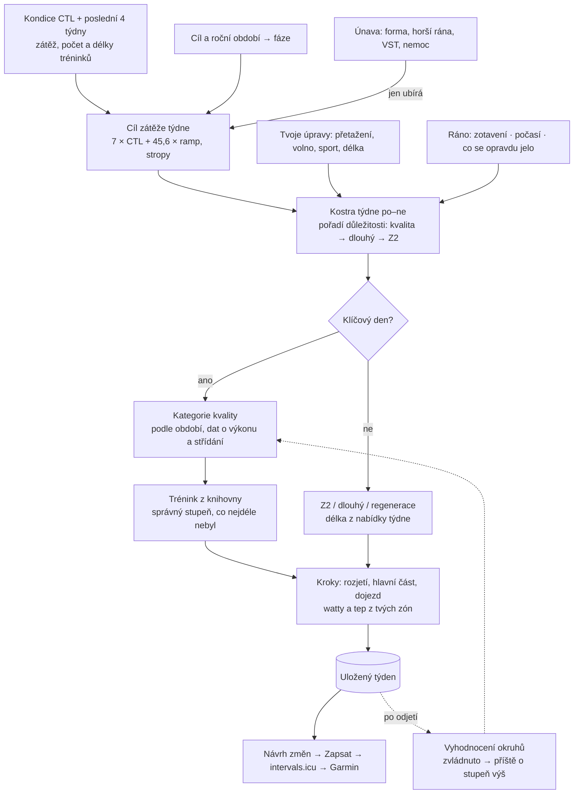

# Jak funguje Trenér v2 (stav k 11. 11. 2026, druhá verze)

Nový plánovač za přepínačem **Nastavení → Trenér → Nový trenér** (`settings.coach_v2`). Když je vypnutý, běží
původní trenér (`docs/jak-funguje-trener.md`). Vzhled stránky je stejný, mění se, **co** se plánuje.

Rozhoduje kód, ne AI (bezplatné modely jsou malé a často přetížené). Postup je převzatý z projektu
[Domestique](https://github.com/platypus45/domestique) (Apache-2.0): stálá kostra, denní úpravy, zmeškaný
trénink se přesune sám, výběr z knihovny s důrazem na pestrost. Z jejich Pythonu je přepsaná jen podstata
a přizpůsobená malému objemu bez nastavených hodin a dnů.

## Schéma: jak vzniká trénink

## 1. Co se nastavuje

Jen tři věci: **hlavní sport** (kolo / běh), **další sporty** (občas běh, v zimě běžky) a **cíl**. Dny ani
hodiny se nenastavují – trénovat jde kdykoli a trénink se dá přetáhnout na jiný den.

## 2. Cíl zátěže týdne (`target.ts`)

Podle specifikace `screenshoty/AI Endurance Coach SPEC.md` (Banisterův model), s opravami.

1. **Z kondice a fáze:** `zátěž = 7 × CTL + 45,6 × ramp`. Ramp (o kolik má kondice za týden růst):
   Zimní pokles −1 · Udržování 0 · Základ +1 · Rozvoj +1,5 až +3 (podle toho, co sportovec v historii unesl) ·
   Ladění −2. Fáze plyne z cíle a ročního období (Pokles → zimní pokles, Udržet → udržování,
   Zlepšit → v zimě základ, v sezóně rozvoj, Závod → podle data).
2. **Strop podle skutečnosti:** nejvýš +30 % (aspoň +40) proti váženému průměru posledních 4 týdnů
   (váhy 1–2–3–4, novější víc). Specifikaci tohle chybělo: s kondicí 43 a týdny po 50–150 by chtěla ~300.
3. **Strop podle délek:** jízdy mají strop (v zimě lehká 75 min, dlouhá 120 min, kvalita 60 min; jinak dlouhá
   nejvýš o 15 % delší než nejdelší za 4 týdny) a tréninků je nejvýš o jeden víc než obvykle. Co se do toho
   nevejde, se nenabízí – jízdy se kvůli číslu nenatahují.
4. **Lehčí týden:** v Základu a Rozvoji každý 4. týden 65 %.
5. **Únava jen ubírá** (forma, horší rána, VST, nemoc).
6. **Dno formy:** výhled formy (TSB) nesmí v plánu spadnout pod −20 (v Rozvoji −30). Jinak se zkrátí lehké
   dny a pak se kvalita změní na vytrvalost.

Trenér vždy napíše, kolik by bylo potřeba na udržení kondice a co nabízený týden s kondicí udělá.

### Co bylo ve specifikaci špatně nebo chybělo

| Specifikace | Problém | Řešení |
|---|---|---|
| `weeklyTSS ≈ 7·CTL + r·k`, k „kalibrovat“ | k je přesně 7 / (1 − 0,9765⁷) = 45,6 | použit přesný vzorec, ověřen výpočtem po dnech |
| Rozvoj +3 až +5 bodů týdně | pro hobby jezdce moc (kondice 43 → +75 % zátěže) | +1,5 až +3, podle prokázané historie |
| zátěž jen z kondice | po slabších týdnech chce skok na ~300 | strop podle posledních 4 týdnů |
| „doplnit lehkými jízdami do cíle“ | v zimě z toho vycházejí jízdy na 2–3 h | stropy délek, zbytek se nenabízí |
| zmeškanou zátěž rozdělit, když to forma dovolí | odporuje zásadě „nedohánět“ | nic se nedohání, jen kvalita se posune |
| „nejvýš 2 těžké dny za sebou“ a zároveň 48 h mezi kvalitami | protimluv | platí 48 h: kvalita ne den po kvalitě ani po dlouhém |
| běh × 1,2 do únavy | rozešlo by se s čísly z intervals.icu | jen pravidlo: kvalita ne den po těžkém běhu |
| VST pod normou nebo tep +5 → jen Z2 | jeden den je šum | používá se zdejší ranní semafor (normy z 60 nocí) |
| posuvník poměru sportů, posuvník fáze | uživatel nechce nastavování | sporty z profilu, fáze z cíle a období |
| horší ráno mimo sezónu: kvalitu vynechat | v pořádku | převzato |

## 3. Kostra týdne (`week.ts`)

Role dne: volno, lehký (Z1), vytrvalost (Z2), klíčový (kvalita), dlouhý. Řešič projde kombinace a oboduje je.

- **Tvrdá pravidla**: nejvýš 3 tréninky za sebou (i přes hranu týdne), klíčový den ne po klíčovém ani po dlouhém.
- **Pořadí důležitosti**: kvalita, dlouhý, pak vytrvalost. Když v týdnu zbývá málo dnů, vytrvalost propadne.
- **Bodují se**: kvalita po volnu, dlouhý o víkendu, pondělí volno, počasí a shoda s dřívější kostrou.
- **Tvoje úpravy** (přetažení, volno, sport, délka, vlastní jízda) platí a zbytek se přeskládá kolem nich.
- **Další sport** nejvýš jednou týdně místo vytrvalostního dne, a jen když kolu zůstane aspoň jeden.

## 4. Kvalita: kategorie a trénink (`library.ts`, `workouts.data.ts`)

Osm kategorií: tempo, sweet spot, práh, over-under, VO2max, VO2 krátké, anaerobní, sprinty.

1. **Které připadají v úvahu** určí období: Základ (zima) tempo / sweet spot / práh / over-under; Rozvoj (sezóna)
   práh / VO2max / krátké VO2 / over-under / anaerobní; lehčí týden sprinty.
2. **Která se vybere**: ta, kterou data nejvíc potřebují (pokles 20min / 5min / 1min výkonu za 6 týdnů a jak
   dlouho chybí podnět) a která nejdéle nebyla. Stejná kategorie dvakrát po sobě nejde.
3. **Trénink z knihovny**: 214 hlavních částí převzatých z Domestique, v každé kategorii 6 stupňů náročnosti.
   Vybere se správný stupeň, který se vejde do délky dne a nebyl mezi posledními deseti.
4. **Kroky**: rozjetí, hlavní část, dojezd. Watty ze zón uživatele (Garmin), lapy podle pravidel aplikace.
5. **Postup**: po čistě zvládnuté kvalitě (okruhy, tep) o stupeň výš (jen Zlepšit a Závod), po nezvládnuté níž.

U každého dne je napsaný účel a důvod, např. „Práh: zvedá výkon na prahu (FTP). Proč teď: 20min výkon za
6 týdnů klesl o 3 %, poslední podnět 30. 10.“

Běh, běžky a kolo bez wattmetru jedou podle tepu z vlastních žebříčků (bpm ze zón Garminu, do intervals.icu
jako % LTHR). Zóny 80/20 Endurance se nepoužívají – viz [`review.md`](review.md).

Knihovnu vyrábí `scripts/build-workout-library.mjs` ze složky `src/workouts` projektu Domestique (kontroluje
smysluplnost každé kategorie a vybírá různé tvary).

## 5. Kdy se plán mění (`engine.ts`)

Plán tohoto a příštího týdne je v tabulce `coach_weeks`. Při čtení se spočítá otisk vstupů; stejný otisk =
uložený plán beze změny. Jinak se přepočítají **jen dny od dneška**.

| Co se stalo | Co trenér udělá |
|---|---|
| 🟡 ráno | kvalita dnes ne, přesune se na další vhodný den; dlouhý o čtvrtinu kratší |
| 🔴 ráno | volno nebo Z1 do 45 min |
| vynechaná kvalita | sama se posune, když je kam; vynechaná Z2 propadne |
| těžká aktivita mimo plán | počítá se jako kvalita, další den kvalita není |
| odjeto víc, než týden nabízel | zbylé vytrvalostní dny se zkrátí |
| nemoc | plán stojí, 2 dny po návratu lehce do 60 min bez kvality |
| pauza přes 14 dní | blok začíná znovu od 1. týdne |
| špatné počasí | kvalita na trenažér, Z2 jinde v týdnu nebo trenažér na 2/3 délky |
| změna profilu / cíle, „Vrátit moje úpravy“ | týden se postaví od nuly |
| nová verze pravidel (`ALGO_VERSION`) | budoucí dny se jednou přepočítají, minulé zůstanou |

Otisk (`PlanInputsFingerprint`) obsahuje všechno, co plán mění: dny a skutečnost, úpravy, nabídku týdne, zotavení,
počasí (i okno na kvalitu venku v zimě), FTP, zóny tepu a LTHR, stupně, kalibraci zátěže, data o schopnostech
(výběr kategorie), kondici a únavu na začátku, připravenost na běh, nemoc kolem týdne a verzi pravidel.

### 5.1 Vyhodnocení klíčových dnů (postup v žebříčcích)

Stav dne: **čeká** → **vyhodnocen** / **vynechán** / **nejasný**. Uzavřený den se už nikdy nepočítá znovu
(starší uložené plány s `evaluated: true` se berou jako uzavřené).

- Aktivita se páruje podle sportu, příznaku kvality, splnění z intervals.icu (spárovaná s plánem) a délky –
  ne podle největší zátěže dne.
- Když aktivita chybí, čeká se **3 dny** (Garmin se může synchronizovat později, např. hodinky nahrají až druhý
  den). Pak je den vynechaný a stupeň zůstává.
- Jiný trénink místo kvality = vynechaná kvalita, stupeň se nesnižuje.
- Dvě stejně možné aktivity = nejasné, stupeň se nemění.
- Kvalita s víc druhy úseků (např. over-under) se hodnotí po blocích, výsledek je nejhorší blok.

### 5.2 Závěrečná kontrola týdne (`validate.ts`)

Běží až po všech úpravách (řešič, zotavení, počasí, dorovnání zátěže, vyvážení formy). Výsledek je
v `coach.validation` a chyby a nesplněné požadavky jdou do upozornění.

| Pravidlo | Porušené samo | Porušené tvou volbou |
|---|---|---|
| nejvýš 3 dny tréninku za sebou | chyba | výjimka |
| kvalita ne den po kvalitě ani po dlouhém (dlouhý po kvalitě smí – víkendový blok, jen mírná penalizace) | chyba | výjimka |
| forma nad hranicí (−20, v rozvoji −30) | chyba | – |
| délka do stropu (kolo podle posledních týdnů, běh 1,5× nejdelšího, aspoň 1 h) | chyba | výjimka |
| čas nad Z2 do 20 % (25 % pod 5 h) | upozornění | – |
| dlouhý trénink a počet kvalit | upozornění | výjimka s důvodem (počasí, nemoc, forma) |

Plán s chybou má `validation.ok = false`. **Akce AI v „Řekni trenérovi“** se po provedení zkontrolují: když
přinesou novou chybu nebo výjimku, dny se vrátí do původního stavu a AI odpoví, proč (AI nesmí obejít pravidla).

### 5.3 Další pojistky

- Knihovna nikdy nevrátí trénink delší než den nebo nad strop času nad Z2. Když se nevejde nic z kategorie,
  zkusí se další; když nic, místo kvality Z2 s vysvětlením.
- Zátěž týdne se počítá ze skutečných tréninků (`coach.plannedLoad`). Když se liší od cíle o víc než 5 %, dorovnají
  se délky vytrvalostních a dlouhých dnů v rámci stropů.
- Dlouhý trénink má přednost před vytrvalostí, i když počet tréninků vyčerpaly lehčí dny.
- Neznámý sport v omezení se ignoruje, délka má strop (kolo 7 h, běh 4 h, vlastní jízda 10 h) v jádře i v API.
- Běh se posuzuje jen z běžecké historie (`run.ts`): intervaly až při pravidelném běhání (aspoň 6 běhů za 60 dní
  a 3 za 4 týdny), po pauze přes 3 týdny bez intervalů. Běžec nedostane „VO2“ podle tepu (byl by to práh).
- Růst kondice v rozvoji podle typického (medián), ne největšího růstu z posledních měsíců.
- Rozdělení intenzity se ukazuje i zvlášť pro kolo (watty) a běh (tep).

## 6. Soubory

| Soubor | Obsah |
|---|---|
| `src/core/coach/*.ts` | čisté funkce (profil, nabídka týdne, kostra, knihovna, postup, engine) |
| `src/core/coach/workouts.data.ts` | generovaná knihovna hlavních částí tréninků |
| `src/coach/store.ts` | čtení a zápis `coach_weeks`, `coach_progress` |
| `src/report/build.ts` → `planForV2` | napojení na data |
| `src/api/coach.ts` | `/coach/profile` |
| `src/core/coach/validate.ts` | závěrečná kontrola týdne |
| `src/core/coach/run.ts` | připravenost na běh |
| `test/coach/coach.test.ts` | pravidla a simulace 8–12 týdnů |
| `test/coach/audit.test.ts` | regresní testy z auditu (listopad 2026) |

## 7. Co zbývá

- Po týdnu ostrého provozu smazat v1 (`src/core/plan.ts` → jen typy, `weekCheck.ts`, AI návrh týdne).
- Výkonnostní cíl (120 km / 4 h).
- Zóny tepu zvlášť pro běh (Garmin je umí, aplikace zatím má jedny).
- Test FTP v lehčím týdnu.
