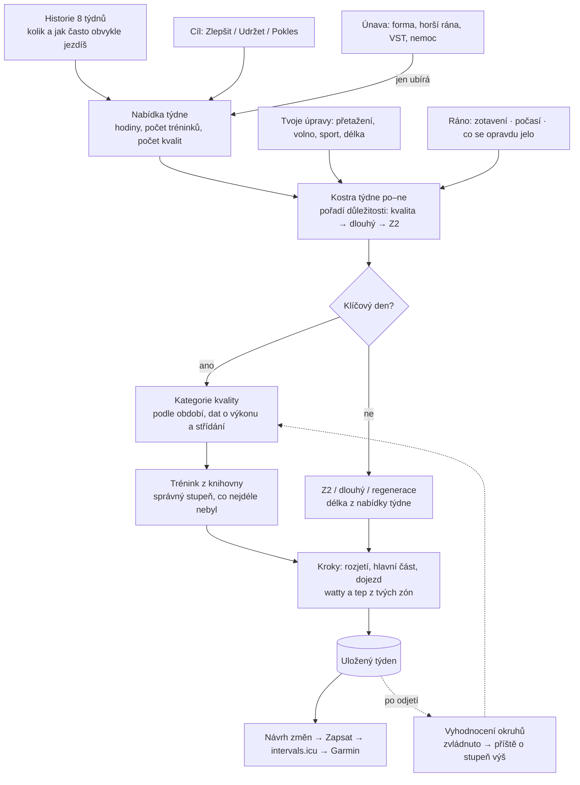

# Jak funguje Trenér v2 (stav k 11. 11. 2026, druhá verze)

Nový plánovač za přepínačem **Nastavení → Trenér → Nový trenér** (`settings.coach_v2`). Když je vypnutý, běží
původní trenér (`docs/jak-funguje-trener.md`). Vzhled stránky je stejný, mění se, **co** se plánuje.

Rozhoduje kód, ne AI (bezplatné modely jsou malé a často přetížené). Postup je převzatý z projektu
[Domestique](https://github.com/platypus45/domestique) (Apache-2.0): stálá kostra, denní úpravy, zmeškaný
trénink se přesune sám, výběr z knihovny s důrazem na pestrost. Z jejich Pythonu je přepsaná jen podstata
a přizpůsobená malému objemu bez nastavených hodin a dnů.

## Schéma: jak vzniká trénink

## 1. Co se nastavuje

Jen tři věci: **hlavní sport** (kolo / běh), **další sporty** (občas běh, v zimě běžky) a **cíl**. Dny ani
hodiny se nenastavují – trénovat jde kdykoli a trénink se dá přetáhnout na jiný den.

## 2. Nabídka týdne (`budget.ts`, `profile.ts → habitOf`)

- **Obvyklý objem** = horní čtvrtina z posledních 8 týdnů, kdy se trénovalo (hodiny a počet tréninků).
  Pár vynechaných týdnů ho nestáhne dolů. Bez historie 3,5 h a 3 tréninky.
- **Cíl**: Udržet = obvyklý objem; Zlepšit = +5 / +10 / +15 % ve třech týdnech bloku, čtvrtý lehčí (65 %);
  Pokles = o trénink míň a 80 % objemu.
- **Pojistky**: nejvýš +15 % proti běžnému týdnu, zátěž do 1,3násobku dlouhodobého průměru.
- **Únava jen ubírá**: forma pod −20 / −30, 2–3 horší rána za 5 dní, týdenní VST pod normou, dny po nemoci.
- Kvalit týdně: 1, při 3 a více trénincích v sezóně a cíli Zlepšit 2, při 5 a více trénincích 2.

Nabídka není limit. Co se vynechá, to se nedohání.

## 3. Kostra týdne (`week.ts`)

Role dne: volno, lehký (Z1), vytrvalost (Z2), klíčový (kvalita), dlouhý. Řešič projde kombinace a oboduje je.

- **Tvrdá pravidla**: nejvýš 3 tréninky za sebou (i přes hranu týdne), klíčový den ne po klíčovém ani po dlouhém.
- **Pořadí důležitosti**: kvalita, dlouhý, pak vytrvalost. Když v týdnu zbývá málo dnů, vytrvalost propadne.
- **Bodují se**: kvalita po volnu, dlouhý o víkendu, pondělí volno, počasí a shoda s dřívější kostrou.
- **Tvoje úpravy** (přetažení, volno, sport, délka, vlastní jízda) platí a zbytek se přeskládá kolem nich.
- **Další sport** nejvýš jednou týdně místo vytrvalostního dne, a jen když kolu zůstane aspoň jeden.

## 4. Kvalita: kategorie a trénink (`library.ts`, `workouts.data.ts`)

Osm kategorií: tempo, sweet spot, práh, over-under, VO2max, VO2 krátké, anaerobní, sprinty.

1. **Které připadají v úvahu** určí období: Základ (zima) tempo / sweet spot / práh / over-under; Rozvoj (sezóna)
   práh / VO2max / krátké VO2 / over-under / anaerobní; lehčí týden sprinty.
2. **Která se vybere**: ta, kterou data nejvíc potřebují (pokles 20min / 5min / 1min výkonu za 6 týdnů a jak
   dlouho chybí podnět) a která nejdéle nebyla. Stejná kategorie dvakrát po sobě nejde.
3. **Trénink z knihovny**: 214 hlavních částí převzatých z Domestique, v každé kategorii 6 stupňů náročnosti.
   Vybere se správný stupeň, který se vejde do délky dne a nebyl mezi posledními deseti.
4. **Kroky**: rozjetí, hlavní část, dojezd. Watty ze zón uživatele (Garmin), lapy podle pravidel aplikace.
5. **Postup**: po čistě zvládnuté kvalitě (okruhy, tep) o stupeň výš (jen Zlepšit a Závod), po nezvládnuté níž.

U každého dne je napsaný účel a důvod, např. „Práh: zvedá výkon na prahu (FTP). Proč teď: 20min výkon za
6 týdnů klesl o 3 %, poslední podnět 30. 10.“

Běh, běžky a kolo bez wattmetru jedou podle tepu z vlastních žebříčků (bpm ze zón Garminu, do intervals.icu
jako % LTHR). Zóny 80/20 Endurance se nepoužívají – viz [`review.md`](review.md).

Knihovnu vyrábí `scripts/build-workout-library.mjs` ze složky `src/workouts` projektu Domestique (kontroluje
smysluplnost každé kategorie a vybírá různé tvary).

## 5. Kdy se plán mění (`engine.ts`)

Plán tohoto a příštího týdne je v tabulce `coach_weeks`. Při čtení se spočítá otisk vstupů; stejný otisk =
uložený plán beze změny. Jinak se přepočítají **jen dny od dneška**.

| Co se stalo | Co trenér udělá |
|---|---|
| 🟡 ráno | kvalita dnes ne, přesune se na další vhodný den; dlouhý o čtvrtinu kratší |
| 🔴 ráno | volno nebo Z1 do 45 min |
| vynechaná kvalita | sama se posune, když je kam; vynechaná Z2 propadne |
| těžká aktivita mimo plán | počítá se jako kvalita, další den kvalita není |
| odjeto víc, než týden nabízel | zbylé vytrvalostní dny se zkrátí |
| nemoc | plán stojí, 2 dny po návratu lehce do 60 min bez kvality |
| pauza přes 14 dní | blok začíná znovu od 1. týdne |
| špatné počasí | kvalita na trenažér, Z2 jinde v týdnu nebo trenažér na 2/3 délky |
| změna profilu / cíle, „Vrátit moje úpravy“ | týden se postaví od nuly |

## 6. Soubory

| Soubor | Obsah |
|---|---|
| `src/core/coach/*.ts` | čisté funkce (profil, nabídka týdne, kostra, knihovna, postup, engine) |
| `src/core/coach/workouts.data.ts` | generovaná knihovna hlavních částí tréninků |
| `src/coach/store.ts` | čtení a zápis `coach_weeks`, `coach_progress` |
| `src/report/build.ts` → `planForV2` | napojení na data |
| `src/api/coach.ts` | `/coach/profile` |
| `test/coach/coach.test.ts` | pravidla a simulace 8–12 týdnů |

## 7. Co zbývá

- Po týdnu ostrého provozu smazat v1 (`src/core/plan.ts` → jen typy, `weekCheck.ts`, AI návrh týdne).
- Výkonnostní cíl (120 km / 4 h).
- Zóny tepu zvlášť pro běh (Garmin je umí, aplikace zatím má jedny).
- Test FTP v lehčím týdnu.
